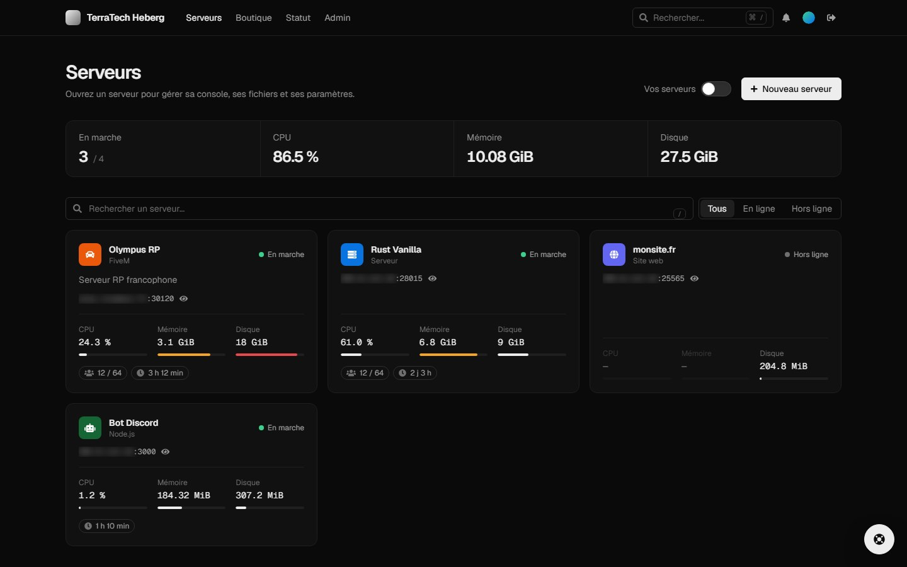
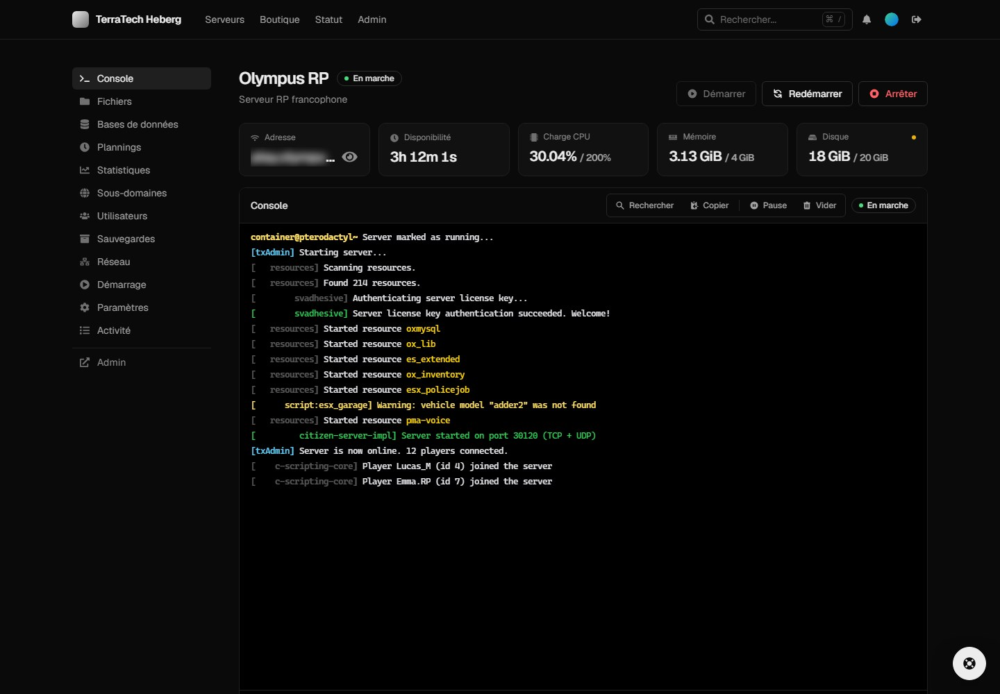
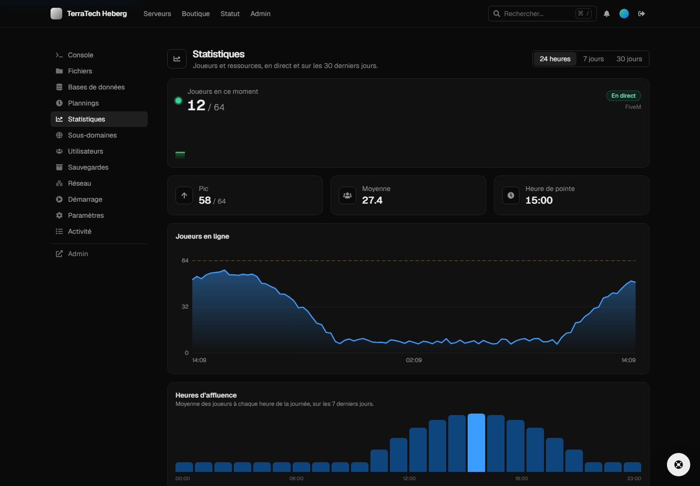
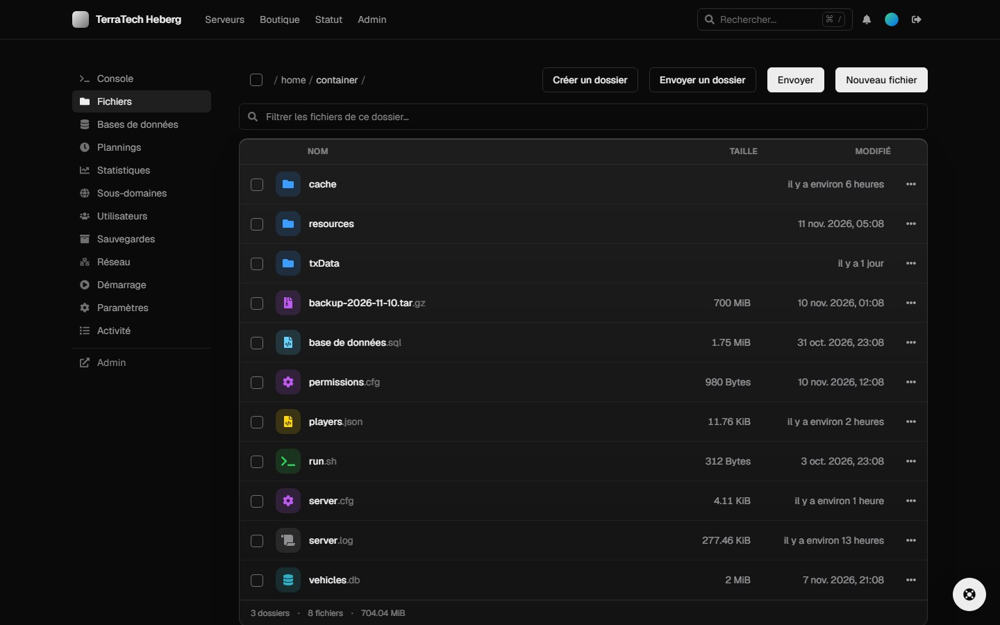
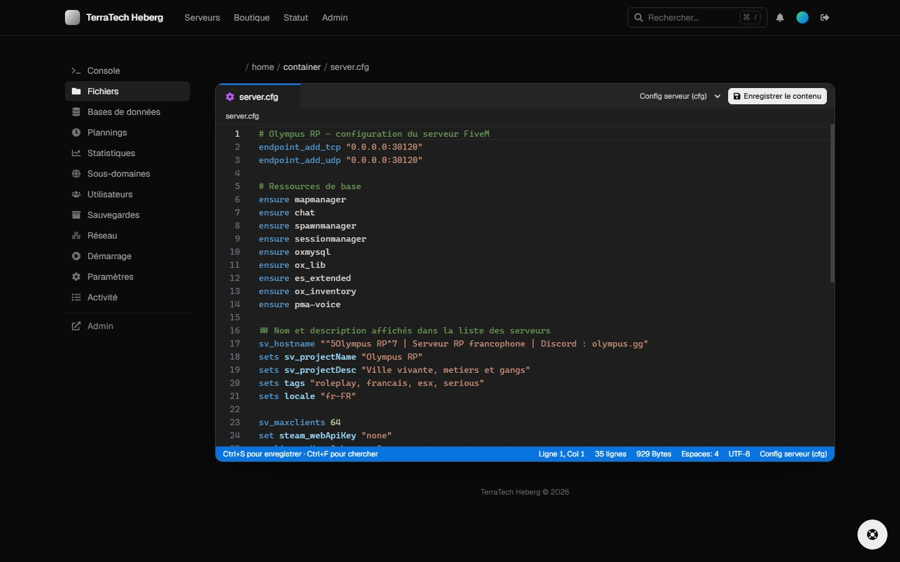
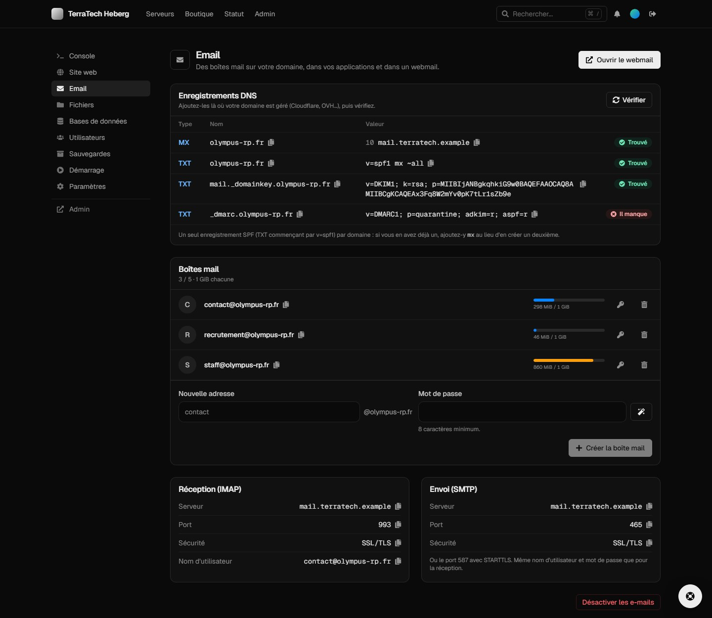
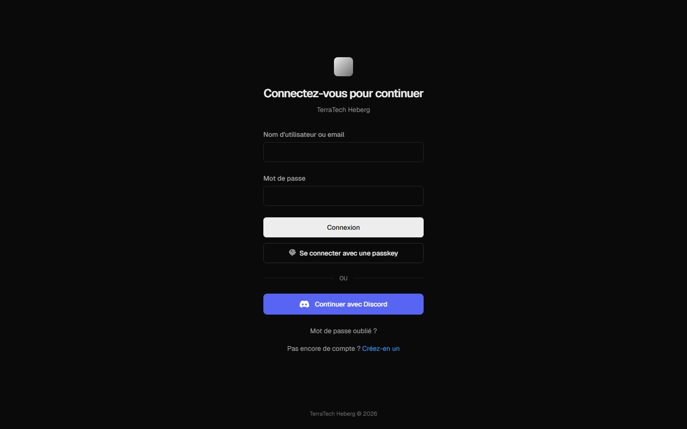
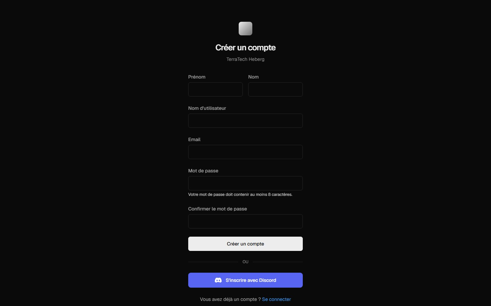
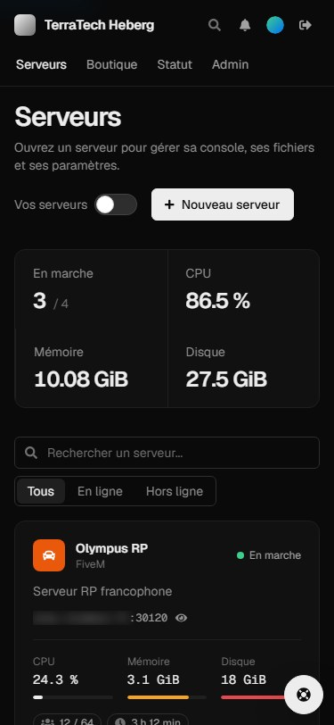
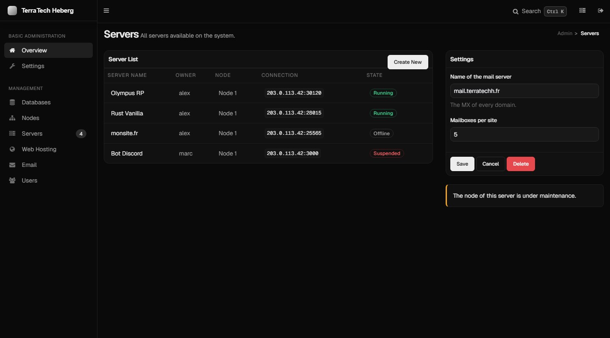

<div align="center">

<br>

# Modern Indigo

### Le panel d'hébergement complet, net et rapide, construit sur Pterodactyl

Serveurs de jeu, **VPS Proxmox**, **sites web**, **boîtes mail**, **boutique**, **bot Discord**, connexion par **Face ID / Windows Hello**…<br>
dans une interface sobre façon Vercel / Linear, pour les clients **et** l'administration, installée avec **une seule commande**.

<br>


[](https://github.com/MisterSuki/panel-Pterodactyl-Modern-Indigo/stargazers)
[](https://github.com/MisterSuki/panel-Pterodactyl-Modern-Indigo/commits/main)
[](https://github.com/MisterSuki/panel-Pterodactyl-Modern-Indigo/issues)

<br>

[**🚀 Installer**](#-installation-en-une-commande) &nbsp;·&nbsp;
[**✨ Fonctionnalités**](#-fonctionnalités) &nbsp;·&nbsp;
[**📸 Aperçu**](#-aperçu) &nbsp;·&nbsp;
[**📚 Documentation**](#-documentation) &nbsp;·&nbsp;
[**❓ FAQ**](#-faq)

<br>

<a href="docs/images/hero.jpg"></a>

<sub>Le tableau de bord. Captures faites avec des données d'exemple.</sub>

<br><br>

<table>
<tr>
<td align="center" width="16%">🖤<br><b>Design pro</b><br><sub>sobre, net, rapide, Geist, ton logo</sub></td>
<td align="center" width="16%">🖥️<br><b>VPS Proxmox</b><br><sub>création, console intégrée, stats en direct</sub></td>
<td align="center" width="17%">🌍<br><b>Sites web</b><br><sub>domaine sans port, HTTPS, WordPress et 7 autres CMS</sub></td>
<td align="center" width="17%">📧<br><b>E-mails</b><br><sub>boîtes mail sur le domaine du site, avec webmail</sub></td>
<td align="center" width="17%">🔑<br><b>Passkeys</b><br><sub>connexion Face ID, Touch ID, Windows Hello</sub></td>
<td align="center" width="17%">🛒<br><b>Boutique</b><br><sub>Stripe, PayPal, SumUp, serveurs créés seuls</sub></td>
</tr>
</table>

</div>

<br>

---

## 🚀 Installation en une commande

Sur ton serveur, **en root** :

```bash
bash <(curl -s https://raw.githubusercontent.com/MisterSuki/panel-Pterodactyl-Modern-Indigo/main/install.sh)
```

Le script te propose un menu, ou tu lui donnes directement ce que tu veux :

| | Ce que tu veux faire | Option |
| :-: | --- | --- |
| **1** | 🆕 Installer le **panel** sur un serveur vierge (nginx, PHP, base de données, Redis, SSL, services) | `--panel` |
| **2** | 🖥️ Installer **Wings**, qui fait tourner les serveurs | `--wings` |
| **3** | 🔀 Installer les **deux** sur la même machine | `--panel --wings` |
| **4** | 🔄 **Mettre à jour** un panel déjà installé avec ce thème | `--update` |
| **5** | ⏪ **Restaurer** les fichiers d'avant une mise à jour | `--restore` |
| **6** | 🧹 **Désinstaller** le thème et retrouver le panel d'origine, sans rien perdre | `--uninstall` |
| **7** | 🗄️ Installer **phpMyAdmin** pour ouvrir les bases depuis le panel | `--phpmyadmin` |
| **8** | 🌍 Installer l'**hébergement web** sur un autre node que celui du panel | `--web` |
| **9** | 📧 Installer le **serveur mail** (commande toute faite dans *Admin → Email*) | `--mail` |
| **10** | 🖥️ Installer ou relancer le **relais de la console des VPS** (fait aussi par `--update`) | `--console` |

> [!TIP]
> S'il détecte déjà un panel dans `/var/www/pterodactyl`, le script passe directement à la mise à jour.
> Ajoute `--dry-run` à n'importe quelle commande pour voir ce qui sera fait **sans rien changer**.
> Après une mise à jour, fais **Ctrl + Maj + R** dans ton navigateur pour charger le nouveau design.

<br>

---

## ✨ Fonctionnalités

<table>
<tr>
<td width="55%"><a href="docs/images/console.jpg"></a></td>
<td width="45%" valign="middle">

### 🎮 Une console claire

- en-tête avec l'état et les boutons **Démarrer / Redémarrer / Arrêter**, qui répondent tout de suite
- **adresse, temps en ligne, CPU, mémoire, disque** en direct, puis le terminal sur toute la largeur
- terminal noir avec couleurs, recherche, copie, **pause**, **vider** et compteur d'erreurs
- **FiveM** : joueurs connectés, bouton **txAdmin** sur ton domaine et son **PIN** ; jeux **Steam** : joueurs via A2S
- explique les plantages courants (comme `-Xmx0M`) en français

</td>
</tr>
<tr>
<td width="45%" valign="middle">

### 📈 Statistiques sur 30 jours

- **joueurs** en direct et sur **24 h, 7 jours ou 30 jours** : pic, moyenne, heures d'affluence
- **ressources** : CPU, mémoire, disque et **temps en ligne**, avec la limite du serveur
- relevé toutes les 5 minutes, pour **tous les jeux** (Minecraft, FiveM, Steam…)

</td>
<td width="55%"><a href="docs/images/statistics.jpg"></a></td>
</tr>
<tr>
<td width="55%"><a href="docs/images/files.jpg"></a></td>
<td width="45%" valign="middle">

### 🗂️ Fichiers

- une **icône et une couleur par type** (config, JSON, logs, archives, .db…), taille, date en français, filtre rapide
- **envoi d'un dossier entier** par glisser-déposer, sans le zipper
- les bases **SQLite (.db)** s'ouvrent dans un vrai lecteur : tables, modification au double-clic, onglet SQL

</td>
</tr>
<tr>
<td width="45%" valign="middle">

### 📝 Un éditeur façon VS Code

- couleurs du thème **Dark+**, onglet du fichier, chemin, barre d'état bleue
- coloration des `server.cfg` de **FiveM**, des `.conf`, `.env`, Lua, JSON, YAML, PHP…
- **Ctrl + S** pour enregistrer, **Ctrl + F** pour chercher, badge quand le fichier n'est pas enregistré

</td>
<td width="55%"><a href="docs/images/editor.jpg"></a></td>
</tr>
<tr>
<td width="55%"><a href="docs/images/mail.jpg"></a></td>
<td width="45%" valign="middle">

### 📧 Des boîtes mail, comme Plesk

- adresses sur le **domaine du site** (`contact@monsite.fr`), avec la taille utilisée
- les enregistrements **MX, SPF, DKIM et DMARC** à ajouter, et un bouton pour **vérifier**
- **webmail** Roundcube, et les réglages pour Outlook, Thunderbird ou l'iPhone
- un vrai serveur mail (docker-mailserver) avec **anti-spam** et **DKIM**, piloté par le panel

</td>
</tr>
</table>

### 🌍 Sites web, comme Plesk

- **sites PHP, HTML, JS, Node.js et Python**, chacun dans son conteneur, avec sa limite de CPU et de mémoire
- **domaine sans port** : `https://monsite.fr`, certificat créé et renouvelé tout seul, `www` compris, **un domaine par site**
- **CMS en un clic** : WordPress, Joomla, PrestaShop, Nextcloud, Dolibarr et Drupal, base de données comprise, et **désinstallation**
- **facturation d'hébergeur** : ClientXCMS, et WHMCS avec ton fichier, chacun avec ta propre licence
- **aperçu** du site, **version de PHP** au choix, sous-domaines gratuits, et vente par la boutique

### 🖥️ Des VPS Proxmox

- relie un ou plusieurs **hôtes Proxmox** avec un jeton d'API : nodes, CPU, mémoire, stockage et machines **en direct**
- **crée des VPS** depuis un modèle cloud-init : vCPU, mémoire, disque, **adresse IP** prise dans ta liste, mot de passe root et clé SSH, démarrage tout seul
- ou **donne** une machine déjà faite sur Proxmox à un client
- côté client : chiffres **toutes les 2 secondes**, graphiques en direct et sur 1 h, 24 h, 7 jours, **Démarrer / Redémarrer / Éteindre / Arrêter**
- **console noVNC intégrée** à la page, avec **zoom**, plein écran, Ctrl+Alt+Del et « taper un texte » ; le jeton Proxmox ne quitte jamais le serveur
- **sous-utilisateurs** : le client partage son VPS avec d'autres comptes, avec seulement les droits voulus (alimentation, console, mot de passe root)

### 🔑 Sans mot de passe

- **Face ID, Touch ID, Windows Hello**, un téléphone ou une clé de sécurité, **sans mot de passe**
- ajoutées et retirées dans *Compte → Passkeys*, avec la date de dernière utilisation
- vérification WebAuthn faite par le panel lui-même : défi à usage unique, site, signature, compteur de l'appareil

### ⛏️ Minecraft et 🚚 Euro Truck

- **Minecraft** : catalogue **Modrinth** (plugins, mods, modpacks), loader et version détectés tout seuls, **joueurs connectés**, whitelist, ops et bannis
- **Euro Truck Simulator 2 / American Truck** : `server_config.sii` en formulaire, modérateurs, mods `.scs`

### 🛒 Une vraie boutique

- offres par **catégorie**, ou serveur **sur mesure**, crédit rechargé par **Stripe, PayPal ou SumUp**
- le serveur est **créé tout seul** après paiement, suspendu à l'échéance, remboursé si la création échoue

### 🔔 Alertes, cloche et bot Discord

- **alertes** de crash, mémoire, disque, démarrage et arrêt, dans la cloche, sur **Discord** (cartes Components V2) et en **message privé**
- une **cloche** de notifications (supprimables) et des **annonces** à tous
- une **page de statut publique** : serveurs de jeu, **VPS**, et des **maintenances** que tu planifies (sans compter dans la disponibilité)
- **bot Discord** : `/servers`, `/status`, `/start`, `/restart`, `/stop` pour piloter **ses** serveurs, avec ses droits du panel

### 🧭 Une administration à la hauteur

- liste des serveurs **en direct** (CPU, mémoire, état) avec actions groupées : démarrer, arrêter, suspendre
- **recherche globale Ctrl + K** : serveurs, utilisateurs, nodes, tickets
- journal de mise à jour **façon terminal**, personnes connectées en temps réel, capacité de chaque node
- pages **Web Hosting**, **Email** et **Bot Discord**, rôles de staff section par section

### Et aussi

<table>
<tr>
<td width="33%" valign="top">

**🔐 Inscription & Discord**<br>
Les visiteurs créent un compte ou se connectent avec **Discord** ; les comptes existants sont liés tout seuls.

</td>
<td width="33%" valign="top">

**🛡️ Rôles de staff**<br>
Modérateur, support… avec des permissions **section par section**, sans donner l'admin complet.

</td>
<td width="33%" valign="top">

**🥚 Eggs en un clic**<br>
Tape le nom d'un egg (Valheim, Palworld…) et il est importé depuis **eggs.pterodactyl.io**.

</td>
</tr>
<tr>
<td width="33%" valign="top">

**🗄️ phpMyAdmin**<br>
Un bouton ouvre la base MySQL d'un serveur, **déjà connecté**.

</td>
<td width="33%" valign="top">

**🧰 Installateur tout-en-un**<br>
Panel, Wings, mise à jour avec **sauvegarde et retour en arrière**, désinstallation qui garde tes données.

</td>
<td width="33%" valign="top">

**🕶️ Discrétion & confort**<br>
**IP floutée** par défaut, mémoire et disque en **GB**, tickets de support, page d'accueil, FR / EN.

</td>
</tr>
</table>

<br>

---

## 📸 Aperçu

### 🔐 Connexion et inscription

<table>
<tr>
<td width="50%"><a href="docs/images/login.jpg"></a></td>
<td width="50%"><a href="docs/images/register.jpg"></a></td>
</tr>
<tr>
<td align="center"><sub>Connexion, avec passkey et Discord</sub></td>
<td align="center"><sub>Inscription</sub></td>
</tr>
</table>

### 📱 Sur téléphone et 🧭 dans l'administration

<table>
<tr>
<td width="28%"><a href="docs/images/mobile.jpg"></a></td>
<td width="72%"><a href="docs/images/admin.jpg"></a></td>
</tr>
<tr>
<td align="center"><sub>Le tableau de bord sur téléphone</sub></td>
<td align="center"><sub>L'administration, dans le même style</sub></td>
</tr>
</table>

<br>

---


## 📚 Documentation

**Sommaire** &nbsp;
[Nouveau serveur](#-nouveau-serveur--le-panel-de-a-à-z) ·
[Wings](#️-wings) ·
[Mise à jour](#-mettre-à-jour-un-panel-existant) ·
[Désinstaller](#-désinstaller-le-thème) ·
[Options](#️-toutes-les-options) ·
[phpMyAdmin](#️-phpmyadmin) ·
[Eggs](#-eggs-de-la-communauté) ·
[FiveM](#-serveurs-fivem) ·
[Minecraft](#️-serveurs-minecraft) ·
[Euro Truck](#-euro-truck-simulator-2--american-truck-simulator) ·
[Boutique](#-boutique-stripe-paypal-sumup) ·
[Notifications](#-notifications-alertes-et-annonces) ·
[Statistiques](#-statistiques--joueurs-et-ressources) ·
[Page de statut](#-page-de-statut-publique) ·
[VPS Proxmox](#️-vps-proxmox) ·
[Hébergement web](#-hébergement-web) ·
[E-mails](#-e-mails-boîtes-mail-des-sites) ·
[Sous-domaines](#-sous-domaines-cloudflare-bunnynet-powerdns) ·
[Bases SQLite](#️-bases-sqlite-db-dans-le-gestionnaire-de-fichiers) ·
[Apparence](#-apparence--fond-animé-image-et-couleurs) ·
[Console](#-console-et-petits-plus) ·
[Passkeys](#-connexion-par-passkey) ·
[Bot Discord](#-bot-discord) ·
[Discord](#-inscription-et-connexion-discord) ·
[Rôles](#️-rôles-de-staff)

### 🆕 Nouveau serveur : le panel, de A à Z

Sur un serveur **vierge** Ubuntu 22.04 / 24.04 ou Debian 11 / 12, avec un nom de domaine qui pointe déjà vers lui :

```bash
bash <(curl -s https://raw.githubusercontent.com/MisterSuki/panel-Pterodactyl-Modern-Indigo/main/install.sh) --panel
```

Il pose quelques questions (domaine, email, compte administrateur) puis fait tout, comme
[pterodactyl-installer](https://pterodactyl-installer.se) :

| Étape | Ce qui est fait |
| :-: | --- |
| 1 | installe **nginx, PHP 8.3, MariaDB et Redis** |
| 2 | crée la **base de données** avec un mot de passe aléatoire |
| 3 | installe le **panel** de ce dépôt (design, inscription, Discord, rôles) et ses dépendances |
| 4 | configure le panel, crée les tables et ton **compte administrateur** |
| 5 | compile le dashboard (avec un peu de swap temporaire si le serveur a peu de mémoire) |
| 6 | obtient un **certificat SSL** gratuit Let's Encrypt |
| 7 | installe la **file d'attente** (`pteroq`) et la **tâche planifiée** (cron) |
| 8 | installe **[phpMyAdmin](#️-phpmyadmin)**, relié au panel (`--no-phpmyadmin` pour l'éviter) |
| 9 | ouvre les ports 80 et 443 si le pare-feu `ufw` est actif |

À la fin, il affiche l'adresse du panel et tes identifiants, et les enregistre dans
`/root/pterodactyl-credentials.txt` (lisible par root seulement, à supprimer ensuite).

<details>
<summary><b>Installer sans aucune question</b></summary>

<br>

```bash
bash <(curl -s https://raw.githubusercontent.com/MisterSuki/panel-Pterodactyl-Modern-Indigo/main/install.sh) \
  --panel --yes --fqdn=panel.example.com --email=toi@example.com --admin-user=toi
```

Sans mot de passe donné, il en génère un aléatoire. Sans domaine (adresse IP), il sert le panel en `http`, sans SSL.

</details>

> [!IMPORTANT]
> **Il ne touche jamais à l'existant** : il refuse de continuer si un panel est déjà installé, si le dossier n'est pas vide,
> ou si une base `panel` ou un utilisateur MySQL `pterodactyl` existent déjà. Si l'installation s'arrête en cours de route,
> relance la même commande : elle reprend proprement.

### 🖥️ Wings

Une fois le panel installé, crée une **Location** puis un **Node** dans *Admin*, puis sur la machine qui héberge les
serveurs de jeu :

```bash
bash <(curl -s https://raw.githubusercontent.com/MisterSuki/panel-Pterodactyl-Modern-Indigo/main/install.sh) --wings
```

Il installe Docker, télécharge Wings et crée le service `wings`. Il te reste à coller la configuration du node
(*Admin → Nodes → ton node → Configuration*) dans `/etc/pterodactyl/config.yml`, puis `systemctl enable --now wings`.

<details>
<summary><b>Tout faire d'un coup</b></summary>

<br>

Donne-lui l'adresse du panel, un jeton d'API et le numéro du node :

```bash
bash <(curl -s https://raw.githubusercontent.com/MisterSuki/panel-Pterodactyl-Modern-Indigo/main/install.sh) \
  --wings --panel-url=https://panel.example.com --wings-token=ptla_xxx --node-id=1
```

</details>

### 🔄 Mettre à jour un panel existant

```bash
bash <(curl -s https://raw.githubusercontent.com/MisterSuki/panel-Pterodactyl-Modern-Indigo/main/install.sh) --update
```

> [!TIP]
> **Mise à jour en un clic.** Après cette commande, la page *Administration → Vue d'ensemble* affiche un bouton
> **Mettre à jour maintenant** dès qu'une nouvelle version du thème sort sur GitHub, et sur la carte **Pterodactyl** quand
> le panel est en retard (pour les administrateurs complets). Il lance la même mise à jour (Pterodactyl compris) et montre
> son avancement en direct ; le panel passe en maintenance quelques minutes puis revient tout seul.
>
> Comment ça marche : le site web n'a pas le droit de modifier le panel, donc l'installateur ajoute un petit service
> systemd (`pterodactyl-theme-update.path`) qui tourne en root. Le bouton dépose seulement un fichier signal ; le service
> le voit, télécharge `install.sh` depuis ce dépôt et lance `--update --yes`. Le contenu du fichier n'est jamais lu, et le
> journal est écrit dans `/var/lib/pterodactyl-theme-update`. Pour retirer ce service :
> `systemctl disable --now pterodactyl-theme-update.path`.

> [!IMPORTANT]
> **Le projet a changé de dépôt.** Il vit maintenant sur [`MisterSuki/panel-Pterodactyl-Modern-Indigo`](https://github.com/MisterSuki/panel-Pterodactyl-Modern-Indigo). L'ancienne adresse `MisterSuki/panel-ptero-terra` n'est plus mise à jour : si tu l'utilises encore, ton panel reste sur une ancienne version. Change l'adresse dans ta commande comme ci-dessus, une seule fois : le nouvel installateur pointe déjà sur le bon dépôt.

Il installe tout le contenu de ce dépôt sur ton panel **1.15.2** : le design, l'inscription, Discord, les rôles et
toutes les fonctionnalités ci-dessus. Il :

1. télécharge le dépôt et vérifie qu'il est complet, sans rien modifier tant que tout n'est pas en règle ;
2. si ton Pterodactyl est **plus ancien** que la version prévue par le thème, il le **met à jour d'abord** avec la version
   officielle (comme le guide de Pterodactyl), après avoir sauvegardé **tout le panel** ;
3. **sauvegarde** chaque fichier qu'il va remplacer (dans `/var/backups/pterodactyl-theme/`) ;
4. met le panel en maintenance (une page d'attente aux couleurs du panel s'affiche, et se recharge toute seule dès qu'il
   revient) et copie les fichiers ;
5. lance les migrations de la base de données ;
6. installe les dépendances et compile le dashboard ;
7. vide les caches, redémarre la file d'attente et remet le panel en ligne.

Si la migration échoue, il remet les fichiers d'origine. Si la compilation échoue, il remet l'ancien dashboard
compilé pour que le panel continue de fonctionner, et t'indique quoi faire. Dans les deux cas, il te dit pourquoi.
Si la mise à jour de Pterodactyl échoue, tout le panel est remis comme avant. Il refuse un panel **plus récent** que la
version prévue par le thème (sauf avec `--force`).

> [!WARNING]
> Fais une **sauvegarde de ta base de données** avant : les migrations ajoutent des colonnes à la table `users` et une
> table `admin_roles`.

**Pour revenir en arrière :**

```bash
bash <(curl -s https://raw.githubusercontent.com/MisterSuki/panel-Pterodactyl-Modern-Indigo/main/install.sh) --restore
```

Les fichiers remplacés sont remis et ceux que la mise à jour a ajoutés sont supprimés. La base de données n'est pas
modifiée : les nouvelles tables et colonnes restent en place sans gêner. Si tu restaures le dashboard, recompile-le
ensuite avec `yarn build:production`.

> [!NOTE]
> **Le design n'apparaît pas ?** L'URL de la feuille de style de l'admin ne change jamais d'une version à l'autre,
> ton navigateur peut donc garder l'ancienne en cache. Fais un rechargement forcé (`Ctrl + Shift + R`)
> ou ouvre le panel dans une fenêtre de navigation privée.

### 🧹 Désinstaller le thème

```bash
bash <(curl -s https://raw.githubusercontent.com/MisterSuki/panel-Pterodactyl-Modern-Indigo/main/install.sh) --uninstall
```

Il remet le panel Pterodactyl officiel, avec son design et son dashboard d'origine. **Rien de ce que tu as créé n'est
perdu** : serveurs, utilisateurs, nodes, allocations, sauvegardes, bases de données, plannings, clés d'API et fichier
`.env` restent exactement comme ils sont. Il :

1. télécharge les fichiers officiels de **ta version** de Pterodactyl (dashboard déjà compilé compris) ;
2. **sauvegarde** les fichiers du thème dans `/var/backups/pterodactyl-theme/uninstall-…` ;
3. met le panel en maintenance, remet les fichiers d'origine et supprime ceux que seul le thème ajoutait ;
4. vide les caches, redémarre la file d'attente et remet le panel en ligne.

<details>
<summary><b>À savoir avant de désinstaller</b></summary>

<br>

- l'inscription, la connexion Discord et les rôles de staff ne fonctionnent plus ; les personnes qui n'avaient
  **qu'un rôle de staff** (et ne sont pas administrateurs) perdent leur accès à l'administration, mais leurs comptes
  et leurs serveurs ne bougent pas ;
- la base de données n'est pas modifiée : les colonnes Discord et la table `admin_roles` restent en place sans gêner
  le panel officiel ;
- le dossier `resources/scripts` est remplacé par celui d'origine (une sauvegarde est faite au cas où tu y aurais
  ajouté tes propres fichiers) ;
- phpMyAdmin reste installé mais le bouton disparaît, car le panel d'origine ne le connaît pas ;
- pour **remettre le thème** tel qu'il était : `bash <(curl -s https://raw.githubusercontent.com/MisterSuki/panel-Pterodactyl-Modern-Indigo/main/install.sh) --restore`.
  Pour installer la dernière version du thème : `--update`.

</details>

### ⚙️ Toutes les options

<details>
<summary><b>Voir la liste complète des options</b></summary>

<br>

| Option | Effet |
| --- | --- |
| `--panel`, `--wings`, `--update`, `--restore`, `--uninstall`, `--phpmyadmin`, `--web`, `--mail`, `--console` | Ce qu'il faut faire (sinon, menu) |
| `-y`, `--yes` | Ne pose aucune question |
| `--dry-run` | Vérifie tout et affiche le plan, sans rien changer |
| `--fqdn=`, `--email=` | Domaine (ou IP) et email, pour un nouveau panel |
| `--admin-user=`, `--admin-password=`, `--admin-first-name=`, `--admin-last-name=` | Compte administrateur créé à l'installation |
| `--timezone=` | Fuseau horaire du panel (celui du serveur par défaut) |
| `--ssl`, `--no-ssl` | Force ou désactive le certificat SSL |
| `--panel-url=`, `--wings-token=`, `--node-id=` | Configure Wings tout de suite |
| `--panel-url=`, `--mail-token=` | Avec `--mail` : l'adresse du panel et la clé de l'agent du serveur mail (*Admin → Email*) |
| `--path=/chemin` | Dossier du panel, si ce n'est pas `/var/www/pterodactyl` |
| `--install-node` | Installe Node.js 22 et Yarn s'ils manquent (Debian/Ubuntu), pour une mise à jour |
| `--enable-settings-ui` | Passe `APP_ENVIRONMENT_ONLY` à `false` dans `.env` (mise à jour) |
| `--skip-build`, `--skip-migrate` | Ne compile pas le dashboard, ne lance pas les migrations |
| `--css-only` | Met à jour seulement le design de l'administration |
| `--force` | Met à jour même si la version du panel est différente (déconseillé) |
| `--no-phpmyadmin` | Avec `--panel` : n'installe pas phpMyAdmin |
| `--pma-source=` | Dossier ou archive `.tar.gz` de phpMyAdmin à utiliser au lieu de télécharger la dernière version |
| `--stock-version=`, `--stock-source=` | Avec `--uninstall` : version officielle à remettre (celle de ton panel par défaut), ou dossier / archive locale à la place du téléchargement |
| `--branch=`, `--repo=`, `--source=` | Installe depuis une autre branche, un autre dépôt (`MisterSuki/panel-Pterodactyl-Modern-Indigo` par défaut) ou un dossier local |

</details>

<br>

---

### 🗄️ phpMyAdmin

Il est installé avec le panel. Sur un panel **déjà installé avec ce thème** (mets-le d'abord à jour avec `--update` si
besoin) et qui tourne sous nginx :

```bash
bash <(curl -s https://raw.githubusercontent.com/MisterSuki/panel-Pterodactyl-Modern-Indigo/main/install.sh) --phpmyadmin
```

Il télécharge la dernière version de phpMyAdmin dans `/var/www/phpmyadmin`, la sert à l'adresse
`https://ton-panel/phpmyadmin/` (une ligne `include` est ajoutée au fichier nginx du panel, testée avec `nginx -t` et
annulée si nginx la refuse) et renseigne `PHPMYADMIN_URL` et `PHPMYADMIN_SECRET` dans le `.env` du panel. Tu peux le
relancer à tout moment : ça met phpMyAdmin à jour en gardant le même secret.

Ensuite, sur la page **Databases** d'un serveur, chaque base a un bouton **phpMyAdmin** : un clic ouvre la base dans un
nouvel onglet, **déjà connecté**, sans mot de passe à copier.

| 🔒 Comment c'est protégé | |
| --- | --- |
| **Lien à usage unique** | valable une minute. Il ne contient ni le mot de passe ni le nom d'utilisateur : le script de connexion de phpMyAdmin les demande au panel, avec un secret partagé qui reste sur le serveur |
| **Permission requise** | *View Password* du serveur (la même que pour voir le mot de passe de la base). L'ouverture est notée dans l'activité du serveur |
| **Pas de formulaire de connexion** | on ne peut entrer dans phpMyAdmin que par ce lien. Ouvrir `/phpmyadmin/` directement renvoie vers le panel |
| **Chacun sa base** | l'utilisateur de base est limité à sa propre base |

> [!NOTE]
> Le serveur qui héberge les bases (*Admin → Database Hosts*) doit accepter les connexions venant de la machine du
> panel : adresse de MariaDB/MySQL ouverte, et utilisateur de base autorisé depuis `%`, comme pour Pterodactyl.

### 🥚 Eggs de la communauté

Dans *Admin → Nests*, la boîte **« Add an egg from the community »** ajoute un egg sans télécharger ni envoyer de fichier :

1. **Tape le nom** de l'egg : la recherche se fait pendant que tu écris, sur les quelque 320 eggs publiés sur
   [eggs.pterodactyl.io](https://eggs.pterodactyl.io/) (jeux, applications et eggs génériques). Les majuscules, les
   espaces et les tirets ne comptent pas (`7days` trouve « 7 Days To Die »).
2. **Choisis le nest** dans « Put it in this nest ». Il propose déjà le bon quand le nom du jeu correspond à un nest
   (un egg Minecraft va vers le nest Minecraft), tu peux le changer.
3. Clique sur **Add** : l'egg est téléchargé et importé, avec ses variables, son script d'installation et ses images
   Docker, puis un bouton **Open** mène à sa page pour le modifier.

Si le nest a déjà un egg du même nom, le panel te le dit et te demande si tu veux l'ajouter quand même.

<details>
<summary><b>Sécurité et prérequis</b></summary>

<br>

C'est le même import que le bouton « Import Egg », donc rien de plus dangereux : le panel ne va chercher que les eggs de
la liste du site, et seulement leur fichier dans les dépôts officiels `pterodactyl/game-eggs`, `application-eggs` et
`generic-eggs`. Il faut la permission **Nests → Manage** (un administrateur ou un rôle de staff qui l'a). La liste est
gardée 6 heures pour aller vite ; le serveur du panel doit pouvoir joindre `eggs.pterodactyl.io` et
`raw.githubusercontent.com`.

</details>

### 🎫 Tickets de support

Un système de tickets intégré, avec **discussion en temps réel** et **transcription**.

- **Côté client** : une **bulle** en bas à droite de chaque page (avec une pastille quand le staff a répondu) qui ouvre une fenêtre de
  discussion sans quitter la page. Chaque utilisateur ouvre un ticket (sujet, catégorie, serveur concerné), discute avec l'équipe dans
  une conversation qui se met à jour toute seule (toutes les 2 secondes tant qu'elle est ouverte), peut fermer et rouvrir son ticket.
  Cinq tickets ouverts au maximum par personne. La page complète reste disponible sur `/tickets`.
- **Voir ce que fait la personne** : dans un ticket (et sur la fiche d'un utilisateur), une carte *Ce qu'il fait* en direct : est-elle sur
  le panel, sur quelle page et quel serveur, et ses dernières actions (celles du journal d'activité que le panel garde déjà). Rien de
  ce qui est tapé (contenu de fichier, commande de console) n'est affiché.
- **Côté administration** : le menu *Support → Tickets* (avec le nombre de tickets en attente). Liste filtrable (à traiter, en attente,
  répondu, fermé), recherche, « les miens » ; dans un ticket, la conversation en direct, les **notes internes** (invisibles pour
  l'utilisateur), la priorité, la prise en charge (« le prendre » ou un autre membre du staff) et la fermeture.
- **L'œil : voir l'écran, avec l'accord de la personne** : sur l'accueil de l'administration (« Actifs en ce moment ») et dans la carte
  *Ce qu'il fait*, un œil demande à voir l'écran de la personne. Elle reçoit une question sur sa page (**Refuser** / **Partager mon
  écran**) ; si elle accepte, **son navigateur lui fait choisir** ce qu'elle partage (un onglet, une fenêtre ou tout l'écran), un bandeau
  rouge lui rappelle que c'est partagé, et elle arrête quand elle veut. L'image passe **directement d'un navigateur à l'autre** (WebRTC) :
  elle ne transite pas par le panel et n'est **pas enregistrée**. Réservé aux administrateurs et au staff qui peuvent gérer les
  utilisateurs ; chaque demande est écrite dans le journal d'activité. Sans l'accord de la personne, rien ne s'affiche.
  *Limite : sans serveur TURN, quelques réseaux très fermés empêchent la connexion (le panel le dit).*
- **Transcription** : à tout moment, en **texte** ou en **page à imprimer** (à enregistrer en PDF depuis le navigateur), dans la langue
  de la personne. L'utilisateur reçoit ce qu'il a vu ; le staff peut avoir la version complète (notes internes et email) ou celle de
  l'utilisateur.
- **Rôles de staff** : une nouvelle section *Support Tickets* (voir / gérer) dans *Rôles de staff*. Un membre du staff qui peut seulement
  voir lit les tickets sans pouvoir répondre.

Les messages sont toujours affichés comme du texte : rien de ce qui est écrit ne peut s'exécuter dans la page.

### 🏠 Page d'accueil pour les visiteurs

Quand on ouvre l'adresse du panel sans être connecté, on arrive sur une **page d'accueil** au lieu d'être renvoyé directement à la connexion.
Elle se modifie dans *Administration → Page d'accueil* : titre, sous-titre, points forts (jusqu'à 6, avec icône), présentation, texte de bas de
page, l'affichage des **offres de la boutique** et celui du **nombre de serveurs hébergés**. Les boutons *Se connecter* et
*Créer un compte* sont **fixes** (non modifiables) pour que la porte d'entrée ne casse jamais. On peut la désactiver (retour à l'ancien
comportement), revenir aux textes d'origine, et la voir à tout moment sur `/welcome`. Les personnes connectées gardent leur tableau de bord.
Tout ce qui est écrit s'affiche comme du texte : rien ne peut s'exécuter.

### 🛒 Boutique (Stripe, PayPal, SumUp)

Une boutique intégrée que l'on **active ou désactive** d'un clic (*Administration → Boutique → Réglages*, réservé aux administrateurs).
Fermée, elle disparaît du tableau de bord et rien ne peut être acheté.

- **Ce qui est vendu** : des **offres de serveur** (œuf, emplacement, mémoire, disque, CPU, limites, durée payée, prix, stock). Après
  paiement, le serveur est **créé automatiquement** pour le client, sur un node de l'emplacement qui a encore de la place.
- **Catégories** : l'administration crée des catégories d'offres (Minecraft, FiveM, bots…) ; le client filtre la boutique par catégorie (seules celles qui ont une offre en vente s'affichent).
- **Crédit** : chaque client a un solde qu'il recharge par **Stripe, PayPal ou SumUp** (montants min/max réglables) et qui sert à payer
  les offres et les renouvellements. S'il lui manque de l'argent, seul le **manque** lui est demandé, et l'achat se fait tout seul dès
  que le paiement est confirmé.
- **Durée fixe, renouvelable à la main** : à l'échéance le serveur est **suspendu** (jamais supprimé, les fichiers restent), et il
  revient dès que le client renouvelle. Une tâche planifiée (`p:shop:expire`, toutes les 5 minutes) s'en occupe.
- **Sûr** : tous les montants sont en centimes ; le solde ne peut jamais devenir négatif ; un paiement n'est crédité **qu'une fois**
  (retour du client, webhook, rechargement de page…) et seulement si le prestataire confirme lui-même le montant et la devise ; si le
  serveur ne peut pas être créé, le client est **remboursé** automatiquement. Les clés API sont **chiffrées** et jamais réaffichées.
- **Côté administration** : offres, commandes, mouvements de crédit et derniers paiements, correction du crédit d'un client (avec le nom
  du membre du staff), et une section *Boutique* dans les rôles de staff (voir / gérer ; les clés restent aux administrateurs).

**Mise en route** : ouvrez *Boutique → Réglages*, renseignez les clés d'au moins un prestataire, ajoutez une offre, puis cochez
« La boutique est ouverte ». Pour Stripe, ajoutez aussi un webhook vers `https://votre-panel/api/payments/stripe` (événements
`checkout.session.completed` et `checkout.session.async_payment_succeeded`) et collez son secret de signature. Utilisez d'abord les
modes de test (clés de test Stripe, PayPal *sandbox*) avant de passer en réel.

### 🖼️ Photo de profil

Chaque utilisateur peut choisir sa photo dans *Mon compte → Photo de profil* (png, jpeg ou webp, 2 Mo au maximum). Sans photo, c'est le
**logo de Pterodactyl** qui s'affiche, partout (barre du haut, administration, discussions du support, journal d'activité).
L'image est vérifiée d'après son contenu (pas son nom), recadrée en carré de 256 px, et gardée **hors du dossier public** : seules les
personnes connectées peuvent la voir.

### 🎮 Joueurs connectés des jeux Steam

Si le jeu ne répond pas à la requête Steam mais écrit le nombre de connexions dans sa console (par exemple
`Incoming connection: … - 3 connections.`), le panel le lit dans la console : le compteur est mis à jour tant que la page
Console est ouverte, et repart de zéro quand le serveur s'arrête ou démarre.

Pour un serveur créé à partir d'un egg **Steam** (image SteamCMD ou variable `SRCDS_APPID` : Source, Rust, ARK, Valheim, Nova-Life…), la
page Console affiche un bloc **Joueurs** (`6 / 25`), rafraîchi toutes les 3 secondes. Le panel interroge le jeu avec la **requête
Steam (A2S)**, en UDP, sur chacune des **allocations** du serveur (la première qui répond est mémorisée). Les bots ne sont pas comptés.

> [!NOTE]
> C'est le **jeu** qui décide de répondre. S'il ne répond pas, le bloc indique *Indisponible*. Dans ce cas, ajoute à ton serveur
> l'allocation du **port de requête** du jeu (souvent 27015 ou le port du jeu +1), le panel l'essaiera tout seul.

### 🎮 Serveurs FiveM

Sur la page *Console* d'un serveur FiveM (ou RedM), le panel ajoute :

- 👥 un bloc **Players** avec le nombre de joueurs connectés et la limite (`12 / 64`), qui passe au jaune puis au
  rouge quand le serveur se remplit. Il se met à jour toutes les 3 secondes environ, même pendant que le serveur démarre ;
- 🔗 un lien **txAdmin** à côté du nom du serveur, qui ouvre txAdmin (`http://adresse:port`) dans un nouvel onglet.
  Le port est celui de la variable `TXHOST_TXA_PORT` de l'egg (`TXADMIN_PORT` sur les anciens eggs, 40120 par défaut) ; le lien est caché si `TXADMIN_ENABLE`
  est à 0.

Le panel interroge lui-même le serveur (`/players.json` et `/info.json` sur son port de jeu), donc rien à installer ni à
configurer : il faut seulement que le port du serveur soit joignable depuis la machine du panel.

> [!NOTE]
> Le lien devient jaune avec un avertissement si le port de txAdmin n'est pas l'une des allocations du serveur
> (onglet *Network*) : il ne serait alors pas joignable de l'extérieur.

### ⛏️ Serveurs Minecraft

Sur un serveur Minecraft, un onglet **Minecraft** apparaît à côté de *Fichiers*. Rien à configurer.

- **Catalogue Modrinth** : plugins & mods, modpacks, packs de ressources et datapacks. Recherche, tri (les plus téléchargés,
  pertinence, nouveautés…) et catégories. Le bouton *Installer* télécharge le bon fichier pour **ta** version, directement sur le
  serveur.
- **Détection automatique** : le loader (Paper, Purpur, Spigot, Fabric, Forge, NeoForge, Quilt…) et la version de Minecraft sont lus
  dans l'egg. Une liste permet de les corriger, et le choix est retenu.
- **Déjà installé** : ce qui est déjà là est marqué *Installé* et ne peut pas être réinstallé tant qu'il n'est pas supprimé. À droite,
  la liste des fichiers installés, à activer, désactiver ou supprimer, et un bouton pour envoyer son propre `.jar`.
- **Joueurs** : les joueurs connectés (avec whitelist, op, kick et ban en un clic), la **whitelist** activable d'un interrupteur,
  les opérateurs et les bannis.

> [!TIP]
> Si le serveur plante au démarrage avec `-Xmx0M`, le panel l'explique dans la console : la mémoire du serveur est sur 0 (illimitée),
> il faut lui donner une vraie valeur.

### 🚚 Euro Truck Simulator 2 / American Truck Simulator

Sur un serveur dédié ETS2 ou ATS, un onglet **Euro Truck** permet de régler le serveur **sans ouvrir de fichier** :

- le `server_config.sii` en formulaire : nom, description, message d'accueil, mot de passe, véhicules, ports, et les règles de jeu
  en interrupteurs (dégâts, trafic, collisions, limiteur, mods…) ;
- les **modérateurs**, par leur SteamID64 (17 chiffres) ;
- les **mods** `.scs` du serveur, à activer, couper ou supprimer, avec un guide pas à pas : activer les mods dans le jeu, lancer
  `export_server_packages` dans la console du jeu, puis envoyer les fichiers `server_packages.sii` et `server_packages.dat` au serveur.

> [!IMPORTANT]
> Arrête le serveur avant d'enregistrer : sinon le jeu peut réécrire le fichier par-dessus tes changements.

### 🔔 Notifications, alertes et annonces

**La cloche** (en haut à droite du panel) rassemble tout ce qui concerne la personne, avec un point rouge pour les non-lus :

- les **alertes de ses serveurs** (voir plus bas) ;
- les **réponses du staff** à ses tickets ;
- la **boutique** : serveur suspendu parce que sa durée est écoulée ;
- les **annonces de l'administration** : maintenance, mise à jour, nouveauté.

*Administration → Annonces* envoie une annonce **à tous les utilisateurs** (information, maintenance, mise à jour, avertissement,
bonne nouvelle), avec un lien si besoin. Ceux qui s'inscrivent ensuite la voient aussi pendant 30 jours. Le bouton **Mettre à
jour maintenant** propose aussi de prévenir les utilisateurs tout seul.

**Alertes des serveurs** (*Paramètres* du serveur → *Alertes*) : crash (y compris un crash redémarré automatiquement par Wings),
mémoire ou disque remplis à 90 %, démarrage, arrêt. Elles vont dans la cloche du propriétaire et des sous-utilisateurs, et dans un
**salon Discord** si un webhook est enregistré (bouton pour envoyer un test). Le panel regarde tous les serveurs **une fois par
minute**, avec une seule requête par node (commande `p:servers:watch`, lancée par la tâche planifiée habituelle du panel). Un
arrêt demandé depuis le panel, la console ou un planning n'est pas compté comme un crash.

### 📈 Statistiques : joueurs et ressources

Un onglet **Statistiques** sur chaque serveur, sur **24 heures**, **7 jours** ou **30 jours** :

- **joueurs** : en direct, la courbe des joueurs connectés, le **pic**, la **moyenne** et les **heures d'affluence**. Le nombre de
  joueurs est lu comme le font les jeux : **Minecraft** (Java et Bedrock), **FiveM** et les **jeux Steam** (requête A2S) ;
- **ressources** : la **moyenne** et le **pic** du processeur et de la mémoire, le disque, et le **temps en ligne**, avec un graphique
  du processeur et un de la mémoire. La limite du serveur est tracée en pointillés.

Tout est relevé toutes les 5 minutes pendant que le serveur tourne (une seule requête par node, avec les alertes), et gardé 30 jours.

### 🟢 Page de statut publique

Activée dans *Administration → Annonces*, elle est à l'adresse `/status` de ton panel, sans compte, avec le même menu que le panel
(les visiteurs voient un bouton *Se connecter*). Elle montre :

- l'**état général** (tout fonctionne, maintenance en cours, services perturbés) et trois chiffres : nodes en ligne,
  disponibilité moyenne sur 7 jours, annonces ;
- les **maintenances** en cours (en orange) et prévues (en bleu), avec leurs horaires et ce qu'elles concernent, puis celles des
  7 derniers jours ;
- le **panel**, chaque **node de jeu** et chaque **node Proxmox** (section *VPS*) avec ses dernières 24 heures en barres d'une
  demi-heure (l'horaire s'affiche au survol) et sa **disponibilité sur 7 jours** ;
- les **annonces** que tu rends publiques, avec leur type (mise à jour, maintenance, incident, résolu…).

Elle se rafraîchit toute seule chaque minute. Les nodes Proxmox sont interrogés toutes les 5 minutes ; la section *VPS* se cache
avec un interrupteur.

**Maintenances** (*Administration → Annonces*, carte *Maintenances*) : un titre, un message, le **début** et la **fin** (dans le
fuseau du panel ; mets l'heure actuelle pour commencer tout de suite), et ce qu'elle concerne : le panel, chaque node, chaque hôte
Proxmox. Une case **prévient tous les utilisateurs** dans la cloche, horaires compris. Pendant la maintenance, ce qu'elle concerne
affiche *Maintenance* au lieu d'une panne, ses barres passent en bleu et **ce temps ne compte pas** dans la disponibilité. Une
maintenance en cours se **termine maintenant** d'un clic ; une maintenance prévue s'**annule**.

### 🖥️ VPS Proxmox

*Administration → Proxmox* (droit de gérer les réglages) relie un ou plusieurs hôtes Proxmox VE, puis donne ou crée des VPS
pour tes clients. Le lien **VPS** apparaît dans le menu d'un client dès qu'il en a un.

**1. Relier un hôte.** Sur Proxmox, crée un **jeton d'API** (*Datacenter → Permissions → API Tokens*) :

- le plus simple : un jeton de `root@pam` **sans** *Privilege Separation* ;
- ou un jeton séparé avec les rôles **PVEVMAdmin**, **PVEDatastoreUser** et **PVEAuditor** sur `/`.

Dans le panel, donne un nom, l'adresse (`https://ip-de-proxmox:8006`), l'ID du jeton (`root@pam!panel`) et son secret, puis
**Tester**. Laisse « Vérifier le certificat » décoché si Proxmox garde le certificat qu'il crée lui-même. Le secret est chiffré avec la clé du
panel. La page affiche ensuite chaque node (CPU, mémoire, stockage, en ligne depuis) et toutes les machines.

**2. Les adresses IP.** Ajoute les IP publiques que tu loues avec leur **masque** (`/32` pour une IP seule), leur **passerelle**
et, si ton hébergeur l'exige (IP failover), leur **adresse MAC virtuelle**. Chaque nouveau VPS en prend une libre.

**3. Créer un VPS.** Il faut un **modèle cloud-init** sur Proxmox (la page donne les commandes pour en faire un avec Debian 12
s'il n'y en a pas). Choisis le client, le modèle, les vCPU, la mémoire, le disque et l'IP : le panel copie le modèle, règle
cloud-init (utilisateur `root`, mot de passe créé au hasard, ta clé SSH si tu en donnes une, adresse IP, DNS), agrandit le disque
et démarre la machine. Le client suit la création sur sa page et voit ensuite son **mot de passe root**. En cas d'échec, l'étape
est retentée 5 fois, puis le bouton **Réessayer** la relance. Supprimer un VPS l'arrête puis le **détruit sur Proxmox**, disques
compris.

**Ou donner une machine existante** : dans le tableau des machines, **Donner** l'attribue à un client (par email ou nom
d'utilisateur), **Reprendre** la lui retire sans toucher à la machine.

**Côté client**, la page d'un VPS montre :

- l'état, les vCPU, la mémoire, le disque, l'**IP principale** et le temps en ligne, mis à jour **toutes les 2 secondes** ;
- la **console** de la machine (noVNC) directement dans la page, avec un **zoom** (Ajuster, 100 % à 200 %), le plein écran,
  Ctrl+Alt+Del et « Taper un texte » pour coller un mot de passe ; elle s'ouvre aussi en grand sur sa propre page ;
- les graphiques **En direct** (3 dernières minutes) ou sur **1 h, 24 h, 7 jours** : CPU, mémoire, réseau ;
- les boutons **Démarrer, Redémarrer, Éteindre** (propre) et **Arrêter** (comme débrancher la prise) ;
- les **sous-utilisateurs** : le propriétaire ajoute d'autres comptes du panel par email et coche ce qu'ils peuvent faire
  (**alimentation**, **console**, **voir le mot de passe root**). Sans case cochée, ils voient seulement l'état et les chiffres.
  Le panel vérifie ces droits à chaque action, et un sous-utilisateur peut quitter le VPS. Reprendre ou supprimer un VPS retire
  ses sous-utilisateurs.

**La console.** Le navigateur ne parle jamais directement à Proxmox : le panel ouvre une session à usage unique (30 secondes)
et un petit relais sur la machine du panel (`pterodactyl-vnc-relay`, service systemd, joint par nginx sur `/vnc-relay/`) la
relie à Proxmox avec le jeton, qui reste sur le serveur. Il est installé par `--update`. *Administration → Proxmox* indique s'il
tourne ; sinon, installe-le ou relance-le seul, en root :

```bash
bash <(curl -s https://raw.githubusercontent.com/MisterSuki/panel-Pterodactyl-Modern-Indigo/main/install.sh) --console
```

> [!TIP]
> Les **adresses IP** trouvées dans la machine s'affichent une fois l'**agent invité QEMU** installé dedans
> (`apt install qemu-guest-agent && systemctl enable --now qemu-guest-agent`) et l'option *QEMU Guest Agent* cochée dans
> Proxmox. L'IP donnée par le panel s'affiche toujours.

### 🌍 Hébergement web

Un site est un serveur créé avec un egg du nest **Web Hosting** : **Site PHP / HTML**, **Site Node.js** ou **Site Python**.
Le client y trouve un onglet **Site web**.

**Mise en route** (*Admin → Web Hosting*) :

1. La mise à jour installe tout sur la machine du panel, si Wings y tourne. Sur un **autre node**, lance en root :
   ```bash
   bash <(curl -s https://raw.githubusercontent.com/MisterSuki/panel-Pterodactyl-Modern-Indigo/main/install.sh) --web
   ```
   Les images PHP se construisent ensuite en arrière-plan, pendant quelques minutes (suivi dans
   `/var/lib/pterodactyl-web/images.log`).
2. Vérifie que le node est **Connecté** sur la page *Web Hosting*.
3. Ajoute un **hôte de bases de données** que les conteneurs peuvent joindre : c'est là que vont les bases des CMS.
4. Crée un serveur (ou une offre dans la boutique) avec un de ces eggs, et **au moins 1 base de données**.

**Comment ça marche.** Un service, `pterodactyl-web-agent`, tourne sur chaque node. Il demande au panel quels domaines
vont vers quels conteneurs (avec le jeton de Wings), écrit ses propres sites Nginx (`ptero-web-*.conf`), obtient les
certificats Let's Encrypt et ferme le port du conteneur à l'extérieur. Il teste Nginx avant chaque rechargement et remet
les anciens fichiers si le test échoue. Un site suspendu affiche une page d'indisponibilité et garde son certificat.

**Domaine d'un client.** Il ajoute son domaine dans l'onglet, puis crée les enregistrements affichés dans son DNS (le
`www` est un enregistrement A, comme le domaine). Avec Cloudflare, le nuage doit être **gris** (« DNS only ») pour que le panel
voie l'adresse du serveur. Un site a **un seul domaine** (domaine perso ou sous-domaine gratuit) ; la limite se règle dans
*Admin → Web Hosting → Domaines par site*.

**CMS.** WordPress, Joomla, PrestaShop, Nextcloud, Dolibarr, Drupal, ClientXCMS et WHMCS (avec ton propre fichier et ta licence)
s'installent en un clic, base de données comprise, et se **désinstallent** de la même façon. L'onglet montre un **aperçu** du site.

**Node.js et Python.** L'application doit écouter sur la variable `PORT`. Sa commande est dans l'onglet *Démarrage*.

**E-mails.** Les sites peuvent avoir des boîtes mail sur leur domaine : voir [E-mails](#-e-mails-boîtes-mail-des-sites).

### 📧 E-mails (boîtes mail des sites)

Un onglet **E-mails** sur chaque site web : le client active les e-mails pour **le domaine de son site**, crée ses adresses
(`contact@monsite.fr`…), change leur mot de passe et voit leur taille utilisée. Il a les enregistrements **MX, SPF, DKIM et
DMARC** à ajouter, avec un bouton **Vérifier**, les réglages **IMAP / SMTP** pour ses applications et un lien vers le **webmail**.

**Mise en route** (*Admin → Email*) :

1. Choisis deux noms, par exemple `mail.ton-domaine.fr` (le serveur mail) et `webmail.ton-domaine.fr`, et crée pour chacun un
   enregistrement **A** vers la machine du serveur mail. Enregistre-les dans la page.
2. Chez l'hébergeur de la machine : règle son **DNS inverse (PTR)** sur `mail.ton-domaine.fr`, et vérifie que le **port 25
   sortant** est ouvert (beaucoup d'hébergeurs le bloquent). Sans ça, Gmail et Outlook refusent les mails.
3. Clique **Créer une clé** : la page affiche la commande à lancer en root sur la machine du serveur mail, du genre :
   ```bash
   bash <(curl -s https://raw.githubusercontent.com/MisterSuki/panel-Pterodactyl-Modern-Indigo/main/install.sh) --mail --panel-url=https://panel.ton-domaine.fr --mail-token=pml_...
   ```
   Il faut **Docker**, **Nginx** et les ports **25, 465, 587 et 993** libres (s'ils sont pris par exim4 ou postfix, le script le dit).
4. La page *Email* montre ensuite l'état : agent connecté, certificats, port 25, DNS inverse, erreurs.

**Comment ça marche.** Un service, `pterodactyl-mail-agent`, tourne sur cette machine. Il lance
[docker-mailserver](https://github.com/docker-mailserver/docker-mailserver) (SMTP, IMAP, anti-spam Rspamd, signature DKIM) et
[Roundcube](https://roundcube.net) (webmail) dans Docker, obtient leurs certificats Let's Encrypt, et demande au panel la liste des
boîtes toutes les 15 secondes. Les mots de passe ne sont gardés que **hachés** (SHA512-CRYPT). L'agent crée la clé **DKIM** de
chaque nouveau domaine et renvoie l'enregistrement au panel. Les messages d'une boîte supprimée sont gardés **7 jours** sur la
machine avant d'être effacés ; un site suspendu garde les siens.

**Limites** : nombre de boîtes par site et taille d'une boîte, dans *Admin → Email*. Les e-mails demandent un **domaine perso** :
un sous-domaine gratuit du panel ne peut pas en avoir.

### 🌐 Sous-domaines (Cloudflare, Bunny.net, PowerDNS)

Chaque serveur peut avoir ses propres adresses, comme `play.ton-domaine.fr`, sans que tu touches au DNS.

**Côté admin** (*Administration → Sous-domaines*, droit de gérer les réglages) :

- ajoute tes **domaines** avec leur fournisseur DNS : **Cloudflare** (jeton d'API *Zone → DNS → Edit*), **Bunny.net DNS** (clé
  d'API) ou **PowerDNS** (adresse et clé de l'API). La connexion est testée avant d'enregistrer (bouton bouclier pour la
  retester), les clés sont **chiffrées** et jamais réaffichées, et chaque domaine peut être rendu indisponible d'un clic ;
- les **noms interdits** : une expression régulière par ligne (`^admin$`, `^www$`…) ;
- les **enregistrements créés** pour chaque sous-domaine : *Adresse* (A, AAAA ou CNAME, choisi tout seul selon l'adresse de
  l'allocation : IP publique, alias ou nom du node), CNAME, TXT et **SRV** (par exemple `_minecraft._tcp` pour que les joueurs
  n'aient pas à taper le port). Variables : `{name}` `{domain}` `{fqdn}` `{ip}` `{port}` `{server}` `{server_name}` ;
- le **nombre de sous-domaines par serveur** par défaut, et celui de chaque serveur sur sa page *Build* ;
- la liste de **tous les sous-domaines**, avec un bouton pour en retirer un.

**Domaines des utilisateurs** (interrupteur *Laisser les utilisateurs ajouter leurs propres domaines*) : dans l'onglet
*Sous-domaines*, un utilisateur ajoute son propre nom, par exemple `play.son-domaine.fr`. Le panel lui affiche les
enregistrements à créer **dans son propre DNS** (A, AAAA ou CNAME vers ton IP, et le SRV), à copier d'un clic, puis **vérifie**
par une requête DNS que le nom mène bien au serveur. Aucune clé n'est demandée et le panel ne modifie rien chez lui. Un nom sous
un de tes domaines est refusé (il doit passer par les sous-domaines), comme le domaine du panel.

**Côté serveur** (onglet *Sous-domaines*, avec les droits de l'onglet Réseau) : créer un sous-domaine (nom, domaine, allocation,
notes), le faire **pointer vers une autre allocation** (les enregistrements DNS sont refaits) ou le supprimer. Quand un serveur est
supprimé, ses sous-domaines et leurs enregistrements le sont aussi.

### 🗃️ Bases SQLite (.db) dans le gestionnaire de fichiers

Un clic sur un fichier `.db`, `.sqlite`, `.sqlite3` ou `.db3` l'ouvre dans un **lecteur de base de données**, sans rien installer :

- la liste des **tables** et des vues, avec leur nombre de lignes ;
- les **données**, 100 lignes par page : **double-clic** sur une case pour la modifier (ou la mettre à NULL), corbeille pour
  supprimer une ligne, bouton pour en ajouter une ;
- la **structure** de chaque table (colonnes, types, clés) et sa requête `CREATE` ;
- un onglet **SQL** pour lancer ses propres requêtes (Ctrl + Entrée).

Les changements restent dans le navigateur jusqu'au bouton **Enregistrer**, qui renvoie le fichier sur le serveur. La base est ouverte
par SQLite compilé en WebAssembly ([sql.js](https://github.com/sql-js/sql.js), licence MIT), jusqu'à 150 Mo.

> [!IMPORTANT]
> Arrête le serveur avant d'enregistrer : un jeu qui tourne garde sa base ouverte et peut écraser tes changements. Si un fichier
> `-wal` est à côté de la base, les derniers changements du jeu n'y sont peut-être pas encore : le lecteur le signale.

### 🎨 Apparence : fond animé, image et couleurs

Dans *Administration → Apparence* (droit de gérer les réglages), l'admin choisit ce qu'il y a **derrière tout le panel** (dashboard,
administration, connexion et page d'accueil) :

- le fond **uni** du thème (par défaut), ou un **dégradé** : Minuit, Océan, Coucher de soleil, Forêt ;
- un **fond animé** : Aurore, Soie, Plasma, Vagues, Lignes, Halo, Faisceaux, Étoiles, Bulles. Il est dessiné par la carte graphique
  (WebGL) à la moitié de la taille de l'écran et à 30 images par seconde au plus, s'arrête quand l'onglet est caché et reste figé pour
  ceux qui ont demandé moins d'animations ;
- **sa propre image** (png, jpeg, webp ou gif, 8 Mo maximum), avec un réglage de **flou**.

Un curseur **assombrit** le fond pour garder le texte lisible, et l'admin choisit la **couleur d'accent par défaut**. Tout s'affiche en
direct sur la page avant d'enregistrer.

Chaque utilisateur a une page *Compte → Apparence* : il choisit sa **couleur d'accent** (bleu, indigo, violet, rose, rouge, orange,
vert, sarcelle, graphite), et **son propre fond** si l'admin le permet (interrupteur « Laisser les utilisateurs choisir leur fond »).
Il peut aussi **figer les animations** pour économiser la batterie. Ses choix sont gardés sur son compte, donc sur tous ses appareils.

**Ton logo** : dans la même page, envoie un logo (png, jpeg, webp, gif ou svg simple, 2 Mo maximum). Il remplace le carré de couleur dans la
barre du haut, l'administration, les pages de connexion, la page d'accueil, la page de statut et la page de mise à jour, et sert
d'icône d'onglet. Un SVG est refusé s'il contient du script ou des liens externes.

> [!NOTE]
> L'image de fond est servie à tout le monde (la page de connexion l'affiche aussi) : n'y mettez rien de privé.

### 🌍 Langues

Le panel est disponible en **anglais** et en **français**.

- **Par défaut : l'anglais.** Dans *Admin → Settings → Language*, tu choisis la langue des **visiteurs** (pages de connexion) et des
  **nouveaux comptes**. Les comptes qui existent déjà gardent leur langue.
- **Chacun choisit la sienne** sur sa page *Account* (carte *Language*) : elle est enregistrée sur le compte et suivie sur tous les appareils.
  Sur les pages de connexion, de petits liens *English · Français* permettent de choisir sans compte.
- Un administrateur peut aussi changer la langue d'un utilisateur depuis sa page (*Admin → Users*).
- Le **dashboard** et les **pages de connexion** sont traduits, l'**administration** en grande partie (les textes techniques longs,
  comme les explications de la configuration Wings, peuvent rester en anglais), ainsi que le journal d'activité et les messages d'erreur
  et de validation. Les emails envoyés par le panel restent en anglais.

Comment c'est fait : les pages sont écrites en anglais, et un petit script (`public/js/translator.js`) remplace chaque texte par sa
traduction avec le dictionnaire `resources/lang/fr.json`. Il ne touche jamais à la console, à l'éditeur de fichiers, aux champs de
formulaire ni aux noms saisis par les utilisateurs (un serveur appelé « Console » reste « Console »). Un texte qui n'est pas dans le
dictionnaire reste en anglais : les phrases construites avec des nombres ou des noms, comme « 3 servers », ne sont pas toutes traduites.

Pour **ajouter une langue** : crée `resources/lang/<code>/` (copie le dossier `en`) et `resources/lang/<code>.json` (copie `fr.json` et
traduis les valeurs). Elle apparaît toute seule dans les listes de langues. Pour **corriger une traduction**, modifie le fichier `.json`
ou `.php` correspondant, puis recharge la page.

### ⏳ Suspension des serveurs

Dans *Admin → Servers → ton serveur → Manage*, la suspension a maintenant :

- une **raison**, écrite par toi et **montrée au client** (« paiement en retard », « signalement d'abus »…) ;
- une **durée** : jusqu'à ce que tu la lèves, ou 1 h, 6 h, 24 h, 3 j, 7 j, 30 j, ou une date précise. À l'échéance, le serveur retrouve son
  accès **tout seul** (vérifié chaque minute par la tâche planifiée du panel) ;
- un bouton **Save changes** pour changer la raison ou la durée d'une suspension en cours, sans toucher au serveur ;
- le détail de qui l'a suspendu, depuis quand et jusqu'à quand.

Ce que voit le client : sur son **dashboard**, la raison sous le nom du serveur et « Access back in 3 hours » ; sur la
**page du serveur**, un écran « Server Suspended » avec la raison, la date de suspension et celle du retour de l'accès.
Dans la liste des serveurs de l'administration, le badge *Suspended* affiche la raison et la date de fin au survol.

L'API Application accepte aussi `reason` et `until` sur `POST /api/application/servers/{id}/suspend`. Une suspension sans
raison ni durée fonctionne comme avant. Les détails sont dans la table `server_suspensions` (créée par la mise à jour) ;
elle ne change rien à la façon dont Pterodactyl gère l'état suspendu.

### ©️ Copyright personnalisé

Dans *Admin → Settings*, les champs **Copyright** et **Copyright Link** remplacent la ligne « Pterodactyl® © 2015 - 2026 » en bas de
toutes les pages : dashboard, connexion et administration. `{year}` est remplacé par l'année en cours (ex. `© {year} TeraTech Heberg`).
Le lien est facultatif (seules les adresses `http://` et `https://` sont acceptées). Vide, c'est la ligne d'origine qui s'affiche.

### 💾 Sauvegardes automatiques

Sur la page *Backups* d'un serveur, une carte **Sauvegardes automatiques** (bouton *Configure*) permet de choisir :

- la **fréquence** : toutes les 6 h, 12 h, tous les jours ou toutes les semaines (à l'**heure** de ton choix pour le jour et la semaine) ;
- le **nombre à conserver** : au-delà, les plus anciennes sauvegardes automatiques sont supprimées ;
- les **fichiers à ignorer**, un chemin par ligne (sinon, le fichier `.pteroignore` du serveur s'applique).

La page affiche aussi une **barre d'usage** (sauvegardes stockées sur la limite du serveur), la **prochaine sauvegarde**, et le dernier
problème s'il y en a eu un. Les sauvegardes automatiques portent une pastille **Auto**, les verrouillées une pastille **Locked**.

> [!IMPORTANT]
> Le panel ne supprime **jamais** une sauvegarde faite à la main ni une sauvegarde **verrouillée**. Si la limite du serveur est atteinte,
> il supprime la plus ancienne sauvegarde *automatique* pour faire de la place ; s'il n'y en a pas, il n'en crée pas et te le dit.

Tout repose sur la tâche planifiée du panel (le `cron` de `schedule:run`, déjà installé), qui vérifie chaque minute. Un serveur
injoignable ou occupé est réessayé 15 minutes plus tard sans gêner les autres. Les réglages sont dans la table
`server_backup_plans`, créée par la mise à jour.

### 🧩 Console et petits plus

| | Ce que ça fait |
| --- | --- |
| 🧭 **Menu du haut** | Liens avec icônes dans un groupe (l'onglet actif est rempli, à ta couleur d'accent), et un **menu de compte** : avatar et nom, puis Mon compte, Apparence, Identifiants API, Clés SSH, Activité, Administration et Se déconnecter |
| ⏳ **Page de mise à jour** | Pendant une mise à jour, une page aux couleurs du panel (ton logo, la durée écoulée) rappelle que les serveurs et VPS continuent de tourner, vérifie toutes les 5 secondes et **se recharge toute seule** quand le panel revient |
| 🔠 **Nom du panel** | Le nom (*Admin → Settings → Company Name*) s'affiche dans la barre du haut, sur les pages de connexion et en bas de chaque page, à la place des mentions de Pterodactyl |
| 🎛️ **Administration relookée** | Même style que le panel : menu plat, compteurs (serveurs, utilisateurs, nodes), cartes, tableaux, boutons, champs, fenêtres et pagination ; recherche **Ctrl + K** ; liste des serveurs en direct |
| 🎫 **Tickets de support** | Conversation en temps réel entre l'utilisateur et le staff, notes internes, priorités, prise en charge, transcription en texte ou à imprimer (voir [Tickets de support](#-tickets-de-support)) |
| 🟢 **Actifs en temps réel** | Sur l'accueil de l'administration, la carte *Actifs en ce moment* liste les personnes qui utilisent le panel, avec **la page où elles sont** (Console, Fichiers, Sauvegardes, Compte, Support…) et le **serveur** concerné, et disparaissent dès qu'elles se déconnectent. Mise à jour toutes les 5 secondes. Actif = une action dans les 2 dernières minutes (le dashboard signale sa page toutes les 30 secondes tant qu'il est à l'écran). Seul le *type* de page est gardé, jamais l'adresse complète ; la liste est réservée à ceux qui peuvent voir les utilisateurs |
| 🧭 **Accueil de l'administration** | Un vrai tableau de bord : nombre de serveurs, utilisateurs, nodes et emplacements, **capacité de chaque node** (mémoire et disque promis aux serveurs, en vert, jaune puis rouge), derniers serveurs et derniers utilisateurs, actions rapides. Un membre du staff ne voit que les sections qui lui sont ouvertes |
| 🗂️ **Dashboard repensé** | Une ligne de chiffres (en marche, CPU, mémoire, disque), puis les serveurs **en grille de cartes** : jeu, état, adresse floutée, **barres** CPU / mémoire / disque qui passent à l'orange puis au rouge, joueurs et temps en ligne ; recherche + filtre En ligne / Hors ligne dès 4 serveurs |
| 🖥️ **Console améliorée** | Terminal noir sur toute la largeur, barre d'outils **Rechercher / Copier / Pause / Vider** et compteur d'erreurs, `[étiquettes]` en bleu, heures en gris, erreurs en rouge, avertissements en jaune, succès en vert, ligne de commande avec bouton d'envoi |
| 🔘 **Boutons d'alimentation** | *Start / Restart / Stop* avec icônes, couleurs, état d'attente pendant que le serveur répond, et *Kill* quand l'arrêt traîne |
| 📈 **Graphiques fluides** | Les courbes CPU, mémoire, **écriture disque** (estimée) et réseau glissent en continu (60 images/s) au lieu de sauter une fois par seconde. Quand le serveur s'éteint, elles **redescendent progressivement à zéro** et restent là ; en passant la souris dessus, une ligne pointillée et une bulle donnent la **valeur exacte** à cet instant (et depuis combien de secondes) |
| ⏸️ **Pause / Clear** | Dans la console, **Pause** gèle l'écran pour lire ou copier (les nouvelles lignes attendent, jusqu'à 5000, et s'affichent au **Resume**). **Clear** vide la console |
| 🕶️ **IP floutée** | L'adresse d'un serveur est floutée sur le dashboard et la console ; un clic sur l'œil l'affiche. Copier l'adresse copie toujours la vraie |
| ⚡ **Dashboard en direct** | CPU, mémoire et disque de tous tes serveurs, rafraîchis toutes les 3 secondes avec **une seule requête** pour toute la page |
| 📊 **Usage des nodes** | Sur la page d'un node : consommation en direct de ses serveurs (CPU, mémoire, disque, réseau) et des serveurs qui consomment le plus |
| 📏 **Mémoire et disque en GB** | À la création d'un serveur et dans sa configuration, on saisit des **GB** ; le panel garde des MiB en interne |
| 💬 **Discord dans les listes** | Le compte Discord lié apparaît dans la liste des utilisateurs et sur la page de chaque utilisateur |
| 🌍 **Anglais et français** | Le panel existe en **anglais** (par défaut) et en **français** : dashboard, pages de connexion et administration. Chacun choisit sa langue sur sa page *Account*, l'administrateur fixe celle des visiteurs et des nouveaux comptes dans *Admin → Settings* (voir [Langues](#-langues)) |
| ⏳ **Suspension améliorée** | Une raison visible par le client, une durée avec **levée automatique**, et le détail affiché sur le dashboard et la page du serveur (voir [Suspension](#-suspension-des-serveurs)) |
| ©️ **Copyright modifiable** | La ligne du bas de page se change dans *Admin → Settings* (voir [Copyright personnalisé](#️-copyright-personnalisé)) |
| 💾 **Sauvegardes automatiques** | Fréquence, nombre à conserver et fichiers ignorés par serveur, avec suppression des plus anciennes (voir [Sauvegardes automatiques](#-sauvegardes-automatiques)) |
| 👥 **Sous-utilisateur par ID Discord** | Dans l'onglet *Users* d'un serveur, invite quelqu'un avec son email **ou son ID Discord** (il doit déjà avoir un compte avec Discord lié) |

> [!NOTE]
> L'usage d'un node est la **somme de ce que consomment ses serveurs** : Wings ne donne pas l'usage du système lui-même.

<br>

---

### 🔑 Connexion par passkey

Chaque utilisateur peut se connecter avec **Face ID, Touch ID, Windows Hello**, son téléphone ou une clé de sécurité, sans taper
son mot de passe :

1. *Compte → Passkeys → Ajouter une passkey* : l'appareil demande le visage, le doigt ou le code, et la passkey est enregistrée.
2. Sur la page de connexion, **Se connecter avec une passkey** : l'appareil montre les passkeys qu'il garde pour le panel.

La passkey remplace aussi le code de l'application d'authentification, puisque l'appareil est déjà déverrouillé par la personne.
Le panel fait toute la vérification WebAuthn lui-même, sans dépendance : défi à usage unique de 5 minutes, nom du site, présence
et vérification de la personne, signature (ES256, Ed25519 ou RS256) et compteur de l'appareil. Les essais ratés sont limités comme
la connexion par mot de passe. Les passkeys ne marchent qu'en **HTTPS**, sur l'adresse du panel.

### 🤖 Bot Discord

Chaque client pilote **ses** serveurs depuis Discord, avec les droits qu'il a dans le panel : `/servers`, `/status`, `/start`,
`/restart` et `/stop`, avec une carte qui montre CPU, mémoire et joueurs et des boutons **Démarrer / Redémarrer / Arrêter /
Actualiser**. Les alertes peuvent aussi arriver **en message privé** (case dans les alertes du serveur). Aucun programme à faire
tourner : Discord appelle le panel (Interactions), chaque appel est vérifié avec la clé publique de l'application.

**Mise en place** (*Admin → Bot Discord*) :

1. Sur le [Discord Developer Portal](https://discord.com/developers/applications), ouvre ton application (ou crée-la).
2. Copie l'**Application ID**, la **Public Key** et le **Bot Token** dans la page, et **enregistre** (le badge passe à « Prêt »).
3. Copie l'**Interactions Endpoint URL** affichée dans *General Information* sur le portail, et enregistre là-bas : Discord
   la teste tout de suite (l'adresse doit être en HTTPS).
4. Envoie les commandes avec le bouton de la page, puis **invite le bot** sur ton serveur Discord.
5. Tes clients lient leur Discord sur la page *Compte* du panel.

### 🔐 Inscription et connexion Discord

<details open>
<summary><b>Ce que ça fait</b></summary>

<br>

- **Inscription** : une case *Allow Registration* dans *Admin → Settings*. Activée, la page de connexion affiche
  « Create one » et les visiteurs peuvent créer un compte (prénom, nom, pseudo, email, mot de passe). Désactivée,
  le panel reste sur invitation. reCAPTCHA protège l'inscription comme la connexion.
- **Connexion Discord** : un bouton « Continue with Discord » sur les pages de connexion et d'inscription.
- **Synchronisation avec un compte existant** : si l'adresse email **vérifiée** du compte Discord correspond à un
  compte du panel, les deux sont liés automatiquement. Un utilisateur peut aussi lier ou délier Discord depuis la
  page *Account*.
- **Nouveaux comptes** : si l'inscription est ouverte, un utilisateur Discord inconnu obtient un compte créé à partir
  de son profil Discord.

</details>

<details>
<summary><b>Garde-fous</b></summary>

<br>

- Un email **non vérifié** côté Discord ne lie jamais un compte et ne permet pas d'en créer un.
- Les **administrateurs et le staff** ne sont pas liés automatiquement par email : ils lient Discord depuis leur
  page *Account* une fois connectés avec leur mot de passe.
- La **double authentification** n'est pas contournée : un compte protégé passe toujours par la page de code 2FA.
- Le *Client Secret* est enregistré chiffré et n'est jamais réaffiché.

</details>

<details>
<summary><b>Mise en place</b></summary>

<br>

1. Sur le [Discord Developer Portal](https://discord.com/developers/applications), crée une application puis, dans
   *OAuth2*, copie le **Client ID** et le **Client Secret**.
2. Dans le panel : *Admin → Settings*, active **Discord Login**, colle le Client ID et le Client Secret, puis copie
   l'URL affichée dans **Discord Redirect URI** vers *OAuth2 → Redirects* sur le portail Discord (l'URL doit être
   identique, y compris `https://`).
3. Dans le fichier `.env`, `APP_ENVIRONMENT_ONLY` doit valoir `false` (une nouvelle installation le fait toute seule,
   la mise à jour avec `--enable-settings-ui`). Avec `true`, le panel ignore les réglages enregistrés depuis
   l'interface : un bandeau rouge le rappelle sur la page Settings.

Les réglages peuvent aussi être fournis par `.env` : `APP_REGISTRATION`, `DISCORD_ENABLED`, `DISCORD_CLIENT_ID`,
`DISCORD_CLIENT_SECRET`.

</details>

### 🛡️ Rôles de staff

Jusqu'ici, on était administrateur (accès à tout) ou simple utilisateur. Les rôles ajoutent un niveau intermédiaire.

1. *Admin → Staff Roles → Create New* : donne un nom (par exemple « Modérateur ») et coche les permissions.
2. Donne le rôle à des personnes : depuis la page du rôle (champ *Add someone*, par pseudo ou email) ou depuis la page
   d'un utilisateur (liste *Staff Role*).
3. Ces personnes voient alors, dans l'administration, uniquement les sections autorisées. Un lien **Admin** apparaît
   aussi dans la barre de navigation du dashboard.

Modifier un rôle s'applique tout de suite à toutes les personnes qui l'ont. Supprimer un rôle les remet simples
utilisateurs, sans rien supprimer d'autre.

**Permissions** : chaque section propose **View** (ouvrir les pages) et **Manage** (modifier). *Manage* inclut toujours *View*.

| Section | View | Manage |
| --- | --- | --- |
| **Servers** | Voir les serveurs | Créer, modifier, suspendre, réinstaller, transférer, supprimer, voir les accès aux bases |
| **Users** | Voir les utilisateurs | Créer, modifier, supprimer des utilisateurs simples |
| **Nodes** | Voir les nodes et allocations | Créer, modifier, supprimer, voir la configuration Wings |
| **Locations, Databases, Mounts, Nests & Eggs** | Voir | Créer, modifier et supprimer ce que la section permet |
| **Panel Settings** | — | Voir et modifier les réglages du panel |

<details>
<summary><b>🔒 Ce qu'un rôle ne peut jamais donner</b></summary>

<br>

- La **clé d'API Application** et la **gestion des rôles** restent réservées aux administrateurs : les deux permettent
  de s'accorder plus de droits.
- Le staff ne peut **pas modifier ni supprimer un administrateur ou un autre membre du staff**, ni donner le statut
  d'administrateur ou un rôle. Sinon, changer l'email ou le mot de passe de quelqu'un reviendrait à prendre son accès.
- Les pages qui affichent des secrets (configuration Wings d'un node, accès aux bases d'un serveur) demandent
  *Manage*, même pour les consulter.
- Si l'authentification à deux facteurs est exigée pour les administrateurs, elle l'est aussi pour le staff.

</details>

<br>

---

## ❓ FAQ

<details>
<summary><b>Je ne vois pas le nouveau design après une mise à jour</b></summary>

<br>

Fais un rechargement forcé avec `Ctrl + Shift + R`, ou ouvre le panel dans une fenêtre de navigation privée : la
feuille de style de l'administration garde la même adresse d'une version à l'autre et peut rester en cache.

</details>

<details>
<summary><b>Est-ce que je perds mes serveurs si je désinstalle le thème ?</b></summary>

<br>

Non. `--uninstall` ne touche pas à la base de données : serveurs, utilisateurs, nodes, sauvegardes, clés d'API et
`.env` restent tels quels. Les fichiers du thème sont sauvegardés, et `--restore` les remet.

</details>

<details>
<summary><b>Le bouton phpMyAdmin n'apparaît pas</b></summary>

<br>

Il faut que phpMyAdmin soit installé (`--phpmyadmin`), que le panel soit à jour (`--update`) et que tu aies la permission
**View Password** sur le serveur. Sans `PHPMYADMIN_URL` et `PHPMYADMIN_SECRET` dans le `.env`, le bouton reste caché.

</details>

<details>
<summary><b>Le nombre de joueurs FiveM reste sur « Waiting… »</b></summary>

<br>

Le panel interroge le port de jeu du serveur : il doit être joignable depuis la machine du panel, et le serveur doit avoir
fini de démarrer. Le compteur se met à jour tout seul dès que FiveM répond.

</details>

<details>
<summary><b>Les mails envoyés arrivent en spam, ou sont refusés par Gmail</b></summary>

<br>

Regarde *Admin → Email* : le **DNS inverse (PTR)** de la machine doit être le nom du serveur mail, et le **port 25 sortant** doit
être ouvert. Côté client, les quatre enregistrements de l'onglet *E-mails* (MX, SPF, DKIM, DMARC) doivent être **Trouvés**. Un SPF
déjà présent (Google, Microsoft…) doit recevoir `mx` au lieu d'un deuxième enregistrement.

</details>

<details>
<summary><b>Le bouton « Se connecter avec une passkey » n'apparaît pas</b></summary>

<br>

Les passkeys demandent le **HTTPS** et un navigateur récent. Ouvre le panel par son adresse en `https://` (pas par l'IP).

</details>

<details>
<summary><b>La console d'un VPS ne s'ouvre pas</b></summary>

<br>

Regarde la carte *Console (noVNC)* dans *Administration → Proxmox*. Si le relais ne tourne pas, lance en root
`bash <(curl -s https://raw.githubusercontent.com/MisterSuki/panel-Pterodactyl-Modern-Indigo/main/install.sh) --console`, puis, s'il ne démarre toujours pas,
`journalctl -u pterodactyl-vnc-relay -n 30` pour voir pourquoi. La machine doit être **en marche**, et le sous-utilisateur doit
avoir le droit *Console*.

</details>

<details>
<summary><b>La page Proxmox dit « 401 » ou « 403 »</b></summary>

<br>

**401** : l'ID ou le secret du jeton est faux. **403** : le jeton n'a pas les droits. Prends un jeton de `root@pam` sans
*Privilege Separation*, ou donne au jeton les rôles **PVEVMAdmin**, **PVEDatastoreUser** et **PVEAuditor** sur `/`.

</details>

<details>
<summary><b>L'installation s'est arrêtée en route</b></summary>

<br>

Relance la même commande : l'installateur est fait pour être répété et reprend là où il s'est arrêté. Le message d'erreur
indique la ligne et la cause.

</details>

<br>

---

## 🧩 Compatibilité

- Conçu pour **Pterodactyl Panel 1.15.2**. Un panel plus ancien (1.15.1…) est mis à jour tout seul vers cette version ;
  un panel plus récent est refusé, car le thème remplace des fichiers du cœur (routes, modèle utilisateur, middlewares).
- Nouvelle installation : **Ubuntu 22.04 / 24.04** et **Debian 11 / 12**. Utilise `bash <(curl ...)` et non
  `curl ... | bash`, sinon le script ne peut pas te poser ses questions.
- Si tu as déjà personnalisé ton panel, compare d'abord les fichiers listés dans
  [`install-manifest.txt`](install-manifest.txt) avec les tiens : ce sont ceux que l'installation remplace.

## 🛠️ Développement

Pour travailler sur le thème en local (Node.js 22+ et Yarn) :

```bash
git clone https://github.com/MisterSuki/panel-Pterodactyl-Modern-Indigo.git
cd panel-Pterodactyl-Modern-Indigo
yarn install
yarn watch   # recompile à chaque modification
```

Les couleurs, la police et les angles sont définis dans [`tailwind.config.js`](tailwind.config.js) et
[`GlobalStylesheet.ts`](resources/scripts/assets/css/GlobalStylesheet.ts) (dashboard client), et dans les variables CSS `--pd-*`
de la dernière partie de [`public/themes/pterodactyl/css/pterodactyl.css`](public/themes/pterodactyl/css/pterodactyl.css)
(administration).

Avant de publier, compile une fois (`yarn build`) : `tsc` ne voit pas les classes que twin.macro refuse, et la mise à jour
compile le dashboard sur le serveur.

> [!IMPORTANT]
> Quand tu ajoutes ou modifies un fichier, ajoute-le à [`install-manifest.txt`](install-manifest.txt) : l'installateur
> ne copie que ce qui est listé.

## 📄 Crédits et licence

Ce projet est un thème construit sur [Pterodactyl Panel](https://github.com/pterodactyl/panel), publié sous
[licence MIT](LICENSE.md). Il n'est ni affilié ni approuvé par le projet Pterodactyl.
Pterodactyl® est une marque de ses propriétaires.

Il utilise aussi les polices [Geist et Geist Mono](https://github.com/vercel/geist-font) (licence SIL OFL, servies par le panel),
[sql.js](https://github.com/sql-js/sql.js) (MIT), et, pour les e-mails, les images Docker de
[docker-mailserver](https://github.com/docker-mailserver/docker-mailserver) (MIT) et de
[Roundcube](https://github.com/roundcube/roundcubemail-docker) (GPL), téléchargées sur la machine du serveur mail.

Un problème, une idée ? Ouvre une [issue](https://github.com/MisterSuki/panel-Pterodactyl-Modern-Indigo/issues) sur le dépôt.

<br>

<div align="center">

**Fait avec 💜 pour les hébergeurs de jeux et de sites**

<sub>Si ce thème te plaît, une ⭐ sur le dépôt fait toujours plaisir.</sub>

</div>
